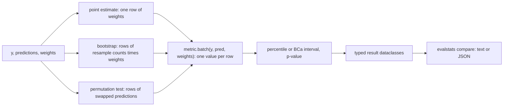

# evalstats

evalstats is a small Python library and command-line tool for comparing machine-learning models
with their uncertainty attached. Given labels and predictions on a test set it computes
classification and regression metrics with bootstrap confidence intervals (percentile or BCa),
compares two models evaluated on the same examples with paired tests (paired bootstrap,
permutation, McNemar, DeLong), adjusts p-values for multiple comparisons (Holm,
Benjamini-Hochberg), measures and corrects calibration (ECE, reliability curves, temperature and
Platt scaling), and tests whether slices of the data differ from the rest. It depends only on
NumPy and SciPy at run time. The implementation is checked by tests that compare metric values
with scikit-learn, DeLong's variance with a brute-force computation, and the coverage and error
rates of each procedure with their nominal values by simulation.

## Quick start

Requires Python 3.11 or newer.

```bash
git clone https://github.com/jersoncoder/evalstats.git
cd evalstats
python -m pip install .
```

Two models scored on the same 500 examples:

```python
import numpy as np
import evalstats as es

rng = np.random.default_rng(0)
y = rng.integers(0, 2, 500)  # true labels
score_a = y + rng.normal(0, 1.0, 500)  # model A
score_b = y + rng.normal(0, 2.0, 500)  # model B, noisier

ci = es.bootstrap_ci(y, score_a, "auc", seed=1)
print(f"AUC of A: {ci.estimate:.3f}, 95% CI [{ci.ci_low:.3f}, {ci.ci_high:.3f}]")

test = es.delong_test(y, score_a, score_b)
print(
    f"AUC of A - B: {test.difference:+.3f}, "
    f"95% CI [{test.ci_low:+.3f}, {test.ci_high:+.3f}], p = {test.p_value:.3f}"
)
```

```text
AUC of A: 0.727, 95% CI [0.681, 0.768]
AUC of A - B: +0.079, 95% CI [+0.013, +0.146], p = 0.020
```

The same comparison from the command line, with the data written to CSV files (a header row and
one column; with an `id` column as well, rows are matched by id instead of by position):

```bash
python - <<'EOF'
import numpy as np
rng = np.random.default_rng(0)
y = rng.integers(0, 2, 500)
np.savetxt("y.csv", y, fmt="%d", header="label", comments="")
np.savetxt("a.csv", y + rng.normal(0, 1.0, 500), header="score", comments="")
np.savetxt("b.csv", y + rng.normal(0, 2.0, 500), header="score", comments="")
EOF
evalstats compare --labels y.csv --a a.csv --b b.csv --metric auc
```

```text
evalstats compare: auc on 500 examples (275 positive)
higher is better; intervals are 95% bca bootstrap, 10000 resamples, seed 0

model         auc  95% CI                file
A          0.7273  [0.6801, 0.7699]      a.csv
B          0.6478  [0.5976, 0.6949]      b.csv

difference A - B = +0.0794
test              95% CI of difference    p-value
paired bootstrap  [+0.0114, +0.1461]      0.02235
DeLong            [+0.0127, +0.1462]      0.01971
permutation       -                       0.0233

the paired bootstrap interval excludes 0: A is better on auc
```

`--json` prints the same report as JSON. `--metric` takes `accuracy`, `precision`, `recall`,
`f1`, `auc`, `average_precision`, `log_loss`, `brier`, `mae`, `rmse` or `r2`; label metrics
threshold the scores at `--threshold` (0.5 by default). The paired bootstrap and the
permutation test are always run; McNemar's test is added for accuracy and DeLong's for AUC.

Slices and calibration:

```python
import numpy as np
import evalstats as es

rng = np.random.default_rng(0)
region = rng.choice(["north", "south", "east", "west"], size=2000)
y = rng.integers(0, 2, 2000)
correct = rng.random(2000) < np.where(region == "east", 0.75, 0.85)  # weaker in the east
pred = np.where(correct, y, 1 - y)

report = es.slice_analysis(y, pred, region, "accuracy", seed=0)
for s in report.slices:
    print(
        f"{s.name:<6} n={s.n}  accuracy {s.estimate:.3f}  rest {s.rest_estimate:.3f}  "
        f"adjusted p = {s.p_adjusted:.4f}"
    )

z = rng.normal(0, 2, 4000)
outcome = (rng.random(4000) < 1 / (1 + np.exp(-z))).astype(int)
prob = 1 / (1 + np.exp(-3 * z))  # three times too confident
scaler = es.fit_temperature(outcome[:2000], prob[:2000])  # fit on a validation half
before = es.expected_calibration_error(outcome[2000:], prob[2000:])
after = es.expected_calibration_error(outcome[2000:], scaler.transform(prob[2000:]))
print(f"temperature {scaler.temperature:.2f}, test ECE {before:.3f} -> {after:.3f}")
```

```text
east   n=520  accuracy 0.760  rest 0.864  adjusted p = 0.0040
north  n=461  accuracy 0.870  rest 0.827  adjusted p = 0.0510
south  n=496  accuracy 0.871  rest 0.825  adjusted p = 0.0510
west   n=523  accuracy 0.851  rest 0.831  adjusted p = 0.2790
temperature 2.96, test ECE 0.133 -> 0.029
```

The east slice is flagged; its adjusted p-value, 0.0040, is four times the smallest p-value that
2000 resamples can resolve (Holm multiplies the smallest of four p-values by four). North and
south come close to the 0.05 line although their true accuracy is the same as west's: the weak
east slice lowers the "rest" each of them is compared with (see Limitations). The temperature
fitted on one half recovers the factor of three, and the calibration error on the other half
drops accordingly.

### A worked example

[`examples/compare_two_models.py`](examples/compare_two_models.py) trains models on the breast
cancer data bundled with scikit-learn (install the development extras first,
`python -m pip install -e ".[dev]"`) and prints:

```text
Breast cancer data: 569 tumours, 30 features, 212 malignant (the positive class).
Stratified 50/50 split (seed 0): 284 train, 285 test (106 malignant). Intervals: BCa bootstrap, 10000 resamples.

1. Logistic regression vs random forest, accuracy
   logistic regression   0.9684  95% CI [0.9439, 0.9860]
   random forest         0.9544  95% CI [0.9228, 0.9754]
   difference            +0.0140  paired bootstrap 95% CI [-0.0105, +0.0421], p = 0.232
   McNemar mid-p         p = 0.302 (only logistic right: 9, only forest right: 5)
   Logistic regression is ahead by 1.4 points, but the interval includes zero.

2. Logistic regression vs a depth-3 decision tree, ROC AUC
   logistic regression   0.9915  95% CI [0.9805, 0.9968]
   decision tree         0.9062  95% CI [0.8576, 0.9399]
   difference            +0.0852  DeLong 95% CI [+0.0478, +0.1227], p = 8.2e-06
                                  paired bootstrap 95% CI [+0.0538, +0.1308], p <= 2.0e-04
   The interval excludes zero: the tree ranks tumours worse.

3. Calibration of Gaussian naive Bayes
   Trained on 198 examples, recalibrated on 86 held-out training examples, measured on the test split.
                                  log loss   ECE (10 equal-mass bins)
   as trained                       0.8378                     0.0591
   temperature (T = 8.51)           0.1808                     0.0449
   Platt (a = 0.117, b = -0.52)     0.1754                     0.0433
   Log loss reduction from temperature scaling: 0.6569, paired bootstrap 95% CI [+0.3468, +1.1923], p <= 2.0e-04.
```

Section 1 is the case this library is for: logistic regression is 1.4 points more accurate
than the random forest, which is easy to report as a win, but with 285 test examples the
interval for the difference runs from about -1 to +4 points and McNemar's test agrees that the
data cannot tell the two apart. In section 2 the AUC gap is large compared with its standard
error and both DeLong's test and the paired bootstrap exclude zero. In section 3 naive Bayes
gives probabilities that are far too extreme, and a temperature fitted on a held-out validation
split cuts the test log loss by more than a factor of four.

## Design



| module | contents |
|---|---|
| `metrics` | the eleven metrics, each a single vectorised batch function, and the `Metric` registry |
| `bootstrap` | resampling as count matrices, percentile and BCa intervals, `bootstrap_ci` |
| `paired` | `paired_bootstrap`, `permutation_test`, `mcnemar`, `delong_test`, `delong_covariance` |
| `multiple` | `holm`, `benjamini_hochberg`, `adjust_p_values` |
| `calibration` | `reliability_curve`, `expected_calibration_error`, `fit_temperature`, `fit_platt` |
| `slices` | `slice_analysis`: per-slice intervals and adjusted slice-versus-rest p-values |
| `cli` | `evalstats compare` |

Every metric is written once, as a function of labels, predictions and weights, where the
predictions and the weights may be matrices with one row per evaluation. A bootstrap resample is
a row of counts (how many times each example was drawn) used as weights, so no resampled copy of
the data is built and sample weights combine with resampling by multiplication. A permutation
test passes a matrix of predictions instead. Rows are processed in blocks of about a million
entries, which bounds memory for any test-set size. The formulas, conventions and references are
in [docs/methods.md](docs/methods.md).

## Decisions and trade-offs

- **One batch implementation per metric**, not a scalar function looped over resamples. The rank
  metrics are less direct to read (tie groups are located with cumulative scans), but point
  estimates, bootstraps and permutations share one code path, the same path the scikit-learn
  cross-checks exercise.
- **Count matrices instead of index arrays.** Statistically the same; counts multiply with sample
  weights, and for rank metrics the scores are sorted once per bootstrap instead of once per
  resample.
- **BCa by default.** It adjusts for bias and skewness of the bootstrap distribution and is
  second-order accurate, where the percentile interval is first-order. It needs a jackknife,
  which is O(n^2) by leave-one-out; above 1000 examples evalstats deletes one of 1000 random
  groups at a time, which estimates the same acceleration constant (tested). When BCa is
  undefined (the estimate lies outside the bootstrap distribution) the result reports a
  percentile interval and says so in its `method` field.
- **Bootstrap p-values by interval inversion.** The paired bootstrap's p-value is the smallest
  level at which its own interval excludes zero, so the interval and the p-value always agree
  (tested). Such p-values are approximate and cannot go below 2/(B+1). When exact size matters
  the permutation test is available; its p-value counts the observed arrangement, so it is valid
  for any number of permutations and never zero.
- **McNemar mid-p by default**, exact available. The exact conditional test is conservative at
  small and moderate sizes (measured below); mid-p stays close to the nominal level. The
  interval for the accuracy difference is Agresti and Min's: the Wald interval after adding one
  half to each cell, which avoids the zero-width intervals of the plain Wald interval.
- **DeLong for AUC differences**: standard, fast and deterministic, but asymptotic, so the CLI
  reports the paired bootstrap next to it and the tests check the two variance estimates against
  each other.
- **Holm by default in slice analysis.** "Which slices are really different" is a family-wise
  question; Benjamini-Hochberg is one argument away for exploratory use with many slices.
- **Calibration fits check that a maximum exists.** When the scores separate the classes, the
  maximum-likelihood temperature or Platt slope does not exist; the fitting functions test the
  exact existence conditions and raise, instead of returning wherever an optimiser stopped.
- **scikit-learn's conventions where the choice is a convention** (ties in AUC, step-wise
  average precision, log-loss clipping, calibration bins), so values agree with reports produced
  by it. scikit-learn itself is only a development dependency.

## How correctness is verified

`pytest` runs 123 tests in about 23 seconds on the machine described below, without network
access; `pytest -m slow` adds a larger simulation of slice analysis under the null (about 20
seconds).

- **Metrics against scikit-learn**: every metric on random inputs, with and without sample
  weights, with tied scores, to within 1e-12. Undefined cases (one class for AUC, no positive
  predictions for precision, constant targets for R2) raise errors that name the cause. Integer
  weights must equal repeated rows, and batch rows must equal separate evaluations.
- **Bootstrap**: BCa and percentile endpoints against `scipy.stats.bootstrap`; the jackknife
  acceleration against its closed form for the mean; the grouped jackknife against
  leave-one-out; stratified resamples keep the class counts.
- **DeLong**: the covariance matrix against a brute-force computation from the full pair kernel
  (to 1e-12, with ties), and its standard error against the paired bootstrap on 3000 examples.
- **McNemar**: exact p-values against `scipy.stats.binomtest`, mid-p and the Agresti-Min
  interval against hand computation. **Permutation test**: against exact enumeration of all 4096
  swap patterns of a 12-example problem. **Holm and BH**: against hand-computed values,
  `scipy.stats.false_discovery_control`, and the step-down and step-up rejection rules.
- **Calibration**: reliability curves against `sklearn.calibration.calibration_curve`; fitted
  temperature and Platt parameters recover the true values of simulated data within four
  standard errors (from the Fisher information) and satisfy the first-order conditions.
- **Simulations with fixed seeds** (`tests/test_simulation.py`): coverage of 95% bootstrap
  intervals; the size under the null of McNemar (compared with its exact size, computed by
  enumeration), of the permutation test and of DeLong's test; the coverage of the Agresti-Min
  interval; the FDR of Benjamini-Hochberg and the FWER of Holm. Each tolerance is stated in units
  of the binomial standard error of the simulated rate, with the reasoning in a comment.
- **The CLI and the example** are tested end to end, including the JSON output and id alignment.

Larger simulations, reproducible with `python scripts/simulation_study.py` (root seed 2026):

**Coverage of 95% intervals (1000 datasets per cell, 1000 resamples each; Monte Carlo SE 0.007)**

| metric | method | n = 50 | n = 200 | n = 1000 |
|---|---|---:|---:|---:|
| auc | percentile | 0.933 | 0.938 | 0.952 |
| auc | bca | 0.964 | 0.966 | 0.948 |
| accuracy | percentile | 0.953 | 0.952 | 0.940 |
| accuracy | bca | 0.964 | 0.958 | 0.938 |
| mae | percentile | 0.935 | 0.942 | 0.954 |
| mae | bca | 0.935 | 0.962 | 0.943 |

**Rejection rate at level 0.05 when both models are equally good (n = 200, 2000 datasets shared by all tests; Monte Carlo SE 0.0049)**

| test | rejection rate |
|---|---:|
| McNemar, exact (accuracy at threshold 0.5) | 0.0370 |
| McNemar, mid-p (accuracy at threshold 0.5) | 0.0510 |
| permutation (Brier score) | 0.0470 |
| DeLong (AUC) | 0.0465 |
| paired bootstrap, BCa (AUC) | 0.0505 |
| paired bootstrap, percentile (AUC) | 0.0450 |

**Multiple comparisons: 20 independent tests, 16 true nulls, alternatives with z ~ N(3, 1), level 0.05 (20000 repetitions)**

| procedure | quantity | estimate | theory |
|---|---|---:|---:|
| Benjamini-Hochberg | false discovery rate | 0.0405 (SE 0.0007) | 0.0400 |
| Holm | family-wise error rate | 0.0466 | at most 0.05 |

No coverage cell is more than 1.7 points from 0.95. The percentile interval for AUC is a
little short at n = 50 and 200 and BCa a little long there; at n = 1000 every cell is within
two Monte Carlo standard errors of 0.95. Under the null the exact McNemar test rejects 3.7% of
the time at a nominal 5% and the mid-p version 5.1%; the other tests are within about one
standard error of 5%, and Benjamini-Hochberg's false discovery rate matches the theoretical
0.04.

Wall-clock time from `python scripts/timings.py` (best of three runs in one process, on one
machine; read it as an order of magnitude):

Python 3.12.14, NumPy 2.5.4, 12th Gen Intel(R) Core(TM) i7-12650H

| procedure | n | seconds for 10000 resamples |
|---|---:|---:|
| bootstrap_ci, accuracy, BCa | 1000 | 0.12 |
| bootstrap_ci, log loss, BCa | 1000 | 0.12 |
| bootstrap_ci, AUC, BCa | 1000 | 0.34 |
| paired_bootstrap, AUC, BCa | 1000 | 0.68 |
| permutation_test, AUC | 1000 | 1.40 |
| bootstrap_ci, accuracy, BCa | 10000 | 1.38 |
| bootstrap_ci, log loss, BCa | 10000 | 1.46 |
| bootstrap_ci, AUC, BCa | 10000 | 4.18 |
| paired_bootstrap, AUC, BCa | 10000 | 8.44 |
| permutation_test, AUC | 10000 | 16.78 |

## Limitations

- **Binary classification and regression only.** No multiclass or multilabel metrics, and the
  calibration tools are for binary probabilities (no temperature scaling of a softmax).
- **Examples are assumed independent.** The bootstrap and the paired tests resample or permute
  single examples. If the test set has several examples per patient, user or document, the
  intervals are too narrow; a cluster bootstrap is not implemented.
- **Only test-set variability.** The intervals describe how the metrics of fixed, trained models
  would vary over test sets. They do not include variation from retraining (seeds, data order,
  training data), and they do not correct for choosing among many models on the same test set.
- **Approximate p-values.** Bootstrap p-values (paired and slice comparisons) come from interval
  inversion and DeLong's test is asymptotic. All tests are two-sided.
- **Binned ECE.** The usual binned estimator, biased upward when bins hold few examples; no
  debiased or kernel estimator. The calibration functions take no sample weights, and isotonic
  regression is not implemented.
- **Slice analysis takes one column at a time** and does not search intersections of slices.
  Slice-versus-rest comparisons are not independent: one weak slice lowers the rest of every
  other slice and can make a typical slice look better than its rest.
- **CPU and NumPy, one process.** A BCa interval with 10,000 resamples on 10,000 examples takes
  seconds (table above), and the permutation test for AUC sorts every permutation.
- **The CLI has one command**, `compare`; slices and calibration are available from Python.
- Not published on PyPI.

## Development

```bash
uv venv .venv && uv pip install -e ".[dev]"   # or: python -m venv .venv && pip install -e ".[dev]"
.venv/bin/ruff check .
.venv/bin/ruff format --check .
.venv/bin/mypy
.venv/bin/pytest                              # fast suite; slow simulations are excluded
.venv/bin/pytest -m slow                      # the larger simulation tests
.venv/bin/python scripts/simulation_study.py  # the tables above
.venv/bin/python scripts/timings.py
```

CI (`.github/workflows/ci.yml`) runs the lint, format, type and test steps on Python 3.11, 3.12
and 3.13.

## License

MIT, see [LICENSE](LICENSE).
